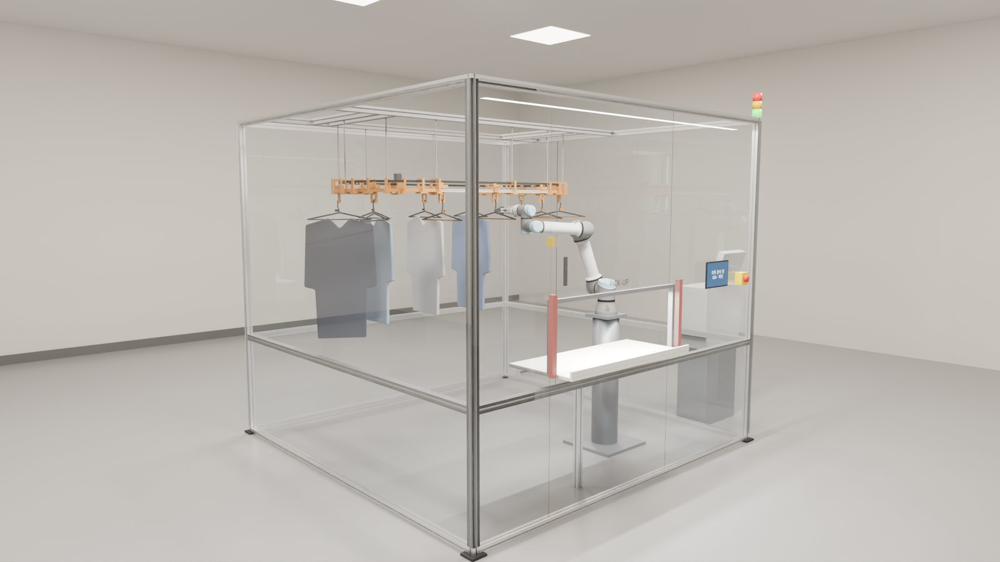
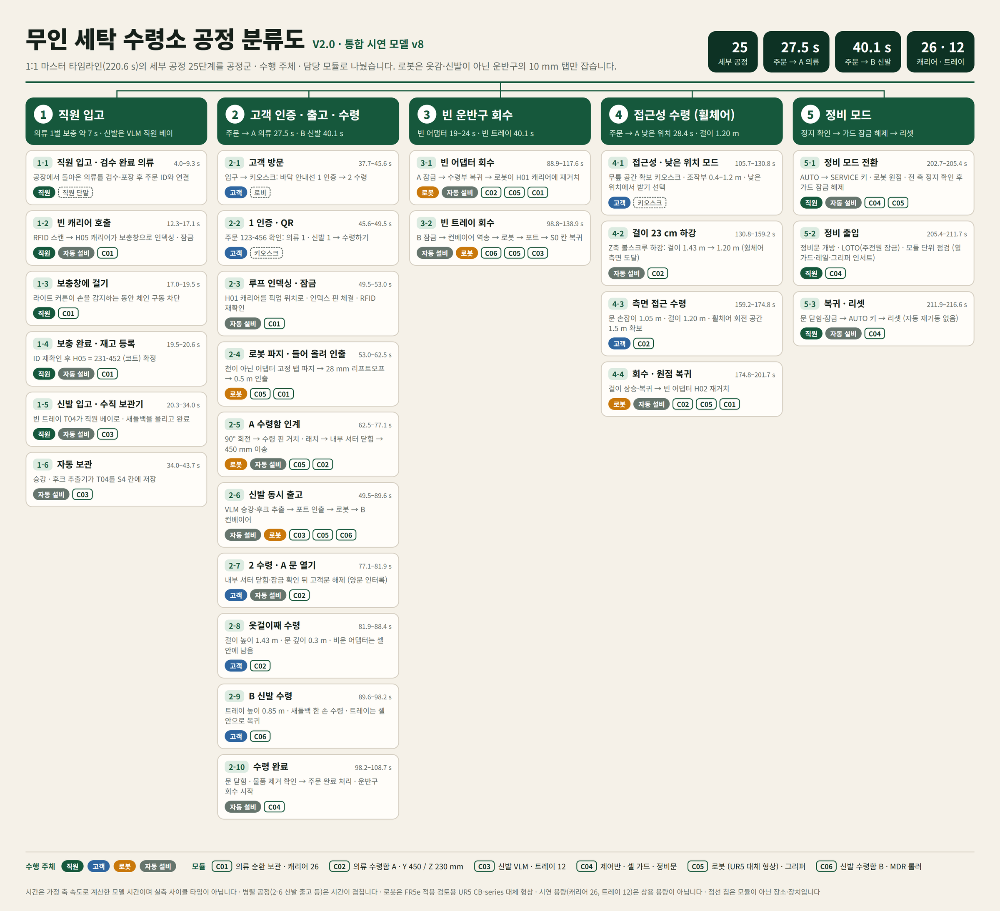
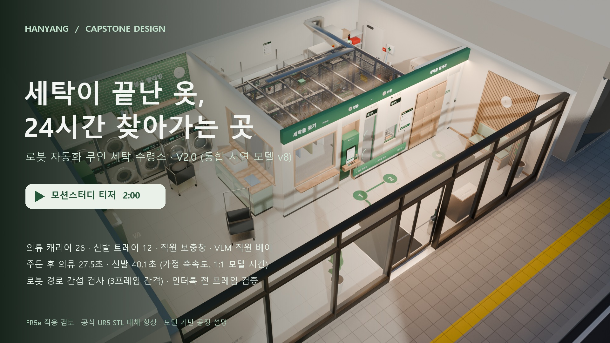

<p align="center">
  
</p>

<p align="center"><a href="README.md">한국어</a> · <b>English</b></p>

# Automated Unmanned Laundry Pickup System (무인 세탁물 수령 시스템)

A Hanyang University Capstone Design project. It's a Blender design for a 24-hour unmanned laundry pickup store, where an automated cell holds finished garments and shoes and hands them to customers who authenticate.

The starting point was simple: let customers collect their laundry without a clerk handing it over. That means the right item has to reach the right person, nobody's hands should ever get near moving machinery, whether staff are loading or customers are picking up, and one cell has to handle both hanging garments and pairs of shoes.

Up front: this is a **visual, geometric and motion design concept**. It isn't a built or certified machine, and every time below is model time computed from assumed axis speeds. The robot is also a UR5 CB-series mesh standing in for the target robot, an FR5e.

## Latest: graduation PoC, 2.5 m cell (2026-11)

This takes just the garment pickup step from the V2.0 store and shrinks it into one 2.5 m x 2.5 m aluminium-profile cell. It uses a UR5e with a DH-Robotics AG-95 gripper, and we tried four variants that only differ in how garments are stored and brought to the robot.

<p align="center"></p>
<p align="center"><sub>Variant A from the front left (Blender Cycles render)</sub></p>

- **A** overhead conveyor: hangers circulate on a loop. 10 carriers, 46.9 s to customer pickup.
- **B** tray rack: folded garments in trays on a rack behind the robot (10 slots). 38.1 s.
- **C** centre robot: three tray racks with 30 slots and a pickup belt. About 32.0 s.
- **D** file-drawer rack: 135 thin tray slots plus a QR check. 65.7 s until the empty tray is back.

The times end at different points, so don't compare them directly. Variant A was assembled in Creo from 17 parts and 223 components, with 0 interference hits over 524 samples of the cell cycle. C has 0 hits over the full cycle; D was checked on 15 representative slots only, and the other 120 were path-planned. A and C also have Creo 2D drawings (for example the [cell layout PDF](poc_2.5m_cell/drawings/CV_CELL_LAYOUT.pdf)). The racks and trays in B, C and D are still Blender concept models, and a hybrid hanger + tray variant is in progress. All the numbers and drawings are in [poc_2.5m_cell/README.md](poc_2.5m_cell/README.md) (Korean).

## V2.0: the whole store

V2.0 doesn't stop at the cell; it designs an entire store. The 10.5 x 7.5 m interior is split into a customer lobby, a self-service laundry, the automated cell and a staff area, and staff, customers and a wheelchair user all move on one 1:1 timeline (6,620 frames, 220.6 s). People and machines only meet at two double-door pickup compartments and two loading points guarded by light curtains. Washing, drying, hanging clothes and inspection/packing are deliberately left as human work; the machine only stores and hands out.

Here's the flow.

1. Staff scan an inspected, packed garment by RFID at the loading window and hang it on an empty carrier. For shoes, the vertical lift module (VLM) presents an empty tray and staff place a saddle bag on it. While a light curtain sees a hand, the machine stops.
2. A customer authenticates at the kiosk with a QR code or pickup number, and garment and shoe preparation start at the same time.
3. The robot never grips fabric or shoes, only a 10 mm tab on the carrier. A garment is lifted 28 mm off its pin, pulled out 0.5 m and moved to compartment A. Shoes ride conveyors to compartment B.
4. The customer door only unlocks once the inner shutter is closed and locked. Order to garment ready is 27.5 s; shoes take 40.1 s.
5. The customer takes just the garment on its hanger and the saddle bag; empty adapters and trays go back on their own.

Inside the cell there are six modules. Garments circulate on the C01 horizontal chain loop with 26 carriers, and shoes are stacked in the C03 VLM with 12 trays. C02 and C06 are pickup compartments A (garments) and B (shoes), C04 is the control cabinet, and C05 is the robot and gripper. Each module has its own frame so it can be swapped as a unit.

A wheelchair user can pick "low position", which lowers the hanger 23 cm to 1.20 m (28.4 s from the order). The kiosk has knee space, controls sit at 0.4-1.2 m, and a 1.5 m turning circle is kept clear in front of the compartments. For service, the SERVICE key homes the robot, and the guard only unlocks after every axis has stopped; a personal padlock (LOTO) goes on the main breaker before anyone steps in. There's no automatic restart.

On safety, we used ISO 10218, ISO 13857, ISO 14119, ISO 14120, ISO 13856-2 and IEC 60204-1 as references for the design intent. No risk assessment or conformity check was done.

<p align="center"></p>
<p align="center"><sub>Process map: 5 process groups, 25 detailed steps, and who (staff, customer, robot, automated equipment) does each step in which module. Labels are in Korean.</sub></p>

The 42 per-step renders are in [docs/v2.0_process_images.md](docs/v2.0_process_images.md), and 8 exploded views of the modules are in [docs/v2.0_exploded_views.md](docs/v2.0_exploded_views.md) (both Korean).

### 2-minute teaser

We cut 15 shots from the timeline into a 2-minute video with Korean synthetic narration. Only the waiting segments are sped up a little, and those shots carry an on-screen speed tag.

[](videos/process_v2.0_teaser_120s_1080p30.mp4)

**[Watch the V2.0 teaser](videos/process_v2.0_teaser_120s_1080p30.mp4)** · 2:00 · 1080p · [Korean subtitles](videos/process_v2.0_ko.srt) · [shot list (Korean)](docs/v2.0_teaser.md)

GitHub doesn't play MP4s inside a README, so the poster takes you to the file page, where you can download it.

## What took the most work

All checks reopen the saved model and actually evaluate frames, and it passes all 7 automated checks: 0 interlock violations over all 6,620 frames and 0 robot interference hits over 1,004 frames. A hanger, tray or saddle bag is always attached to exactly one owner (carrier, robot, compartment or a hand), and across 31 handoffs the position never jumps more than 0.78 mm. The mannequins were checked too, for foot slip while walking (0.00 mm) and for hands landing exactly on what they grab. That said, this only covers geometry and logic states inside Blender; real loads, sensor response and safety-circuit performance weren't tested.

The part we chewed on longest was how to pull a garment out. Garments hang perpendicular to the rail, so at the wheel they fan out. Gripping the tab at the tip, lifting a little, and pulling out radially clears the outer ends of the neighbours. Giving garment adapters and shoe trays the same 10 mm stainless tab was also so one gripper could handle both.

It wasn't clean from the start. An early path swept the robot arm right through a corner post of compartment A. Interference only reached 0 after preferring elbow-up IK solutions and increasing the retreat in front of the shutter from 0.16 m to 0.40 m. In the video, a staff member once walked through the camera position and about 0.5 s of mannequin interior flashed black on screen, so we wrote a separate check that measures camera-to-person distance every frame. The kiosk also showed the previous customer's order number at one point, which we fixed later. The hanger lowering happens behind a closed shutter where you can't see it, so instead of moving the mechanism, a section camera hides one liner of the compartment and the screen says it's a section view.

Every axis and signal is driven by properties on a single control rig, `V8_CTRL`. All 223 drivers are simple expressions, so it runs without Python auto-run. The full criteria and fixes are in the [verification record](docs/v2.0_verification.md) (Korean).

## How to view

There's nothing to install. A browser is enough, plus a player that can load SRT files if you want subtitles.

```bash
git clone https://github.com/lsy041015/capstone-design-hanyang-university.git
cd capstone-design-hanyang-university

# e.g. play the V2.0 teaser in mpv with the Korean subtitles
mpv --sub-file=videos/process_v2.0_ko.srt videos/process_v2.0_teaser_120s_1080p30.mp4
```

If you want to dig deeper, start with the [process design](docs/v2.0_process_design.md) (layout, modules, sequence, timing, safety, maintenance; Korean). The 52 design signals, the parts/maintenance list and the control properties are CSV files in `docs/`. The older v7 write-up is in [docs/v7_overview.md](docs/v7_overview.md), and the v7 and v4 videos are still in `videos/`. v7 modelled only the cell, so its numbers differ from V2.0.

## What it isn't yet

Getting to real hardware would take a lot more: re-verifying the paths with real FR5e CAD, sizing the chain, belts and gripper for load and torque, and building and testing a PLC and safety circuit. Garments are rigid approximations, the people are mannequins for flow studies, and payment, QR and inventory exist only as screens and logic conditions. The demo capacity (26 garments, 12 shoe trays) doesn't say anything about commercial capacity or profitability, and the repo has no market or cost analysis. The editable `.blend` file and the generator scripts aren't published either, so you can't open the model or rerun the checks from this repo alone.

## Credits

- The robot geometry is Universal Robots' official UR5 CB-series STL ([ROS 2 Description](https://github.com/UniversalRobots/Universal_Robots_ROS2_Description/tree/89bbe795f38a7ab00fb66fe8831dfff79dc99edf/meshes/ur5/collision), commit `89bbe795`). The BSD-3-Clause notice is in [docs/UR5_LICENSE.txt](docs/UR5_LICENSE.txt) and covers only those meshes. Please don't read UR5 specs as FR5e performance.
- The narration is the Windows Microsoft Heami Desktop synthetic voice; the ambient sound was synthesized with NumPy.
- There's no repository-wide license file.

---

<p align="center"><sub>LSY.KOR · <a href="https://github.com/lsy041015">More projects</a></sub></p>
