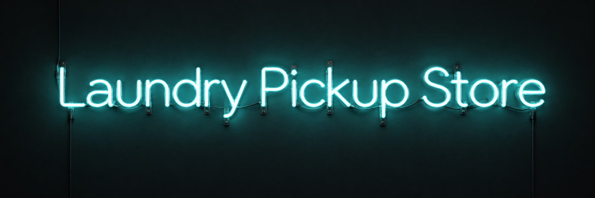
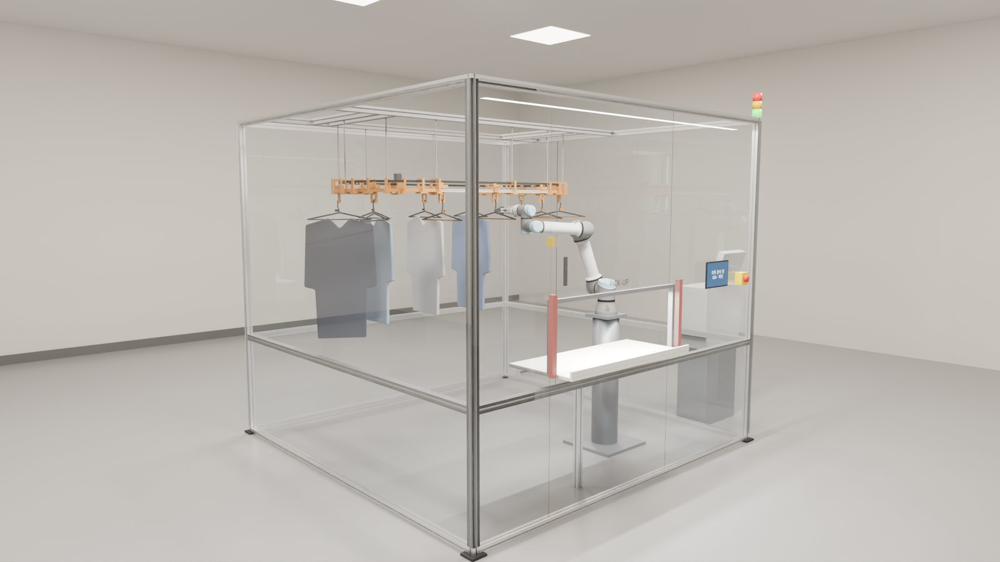
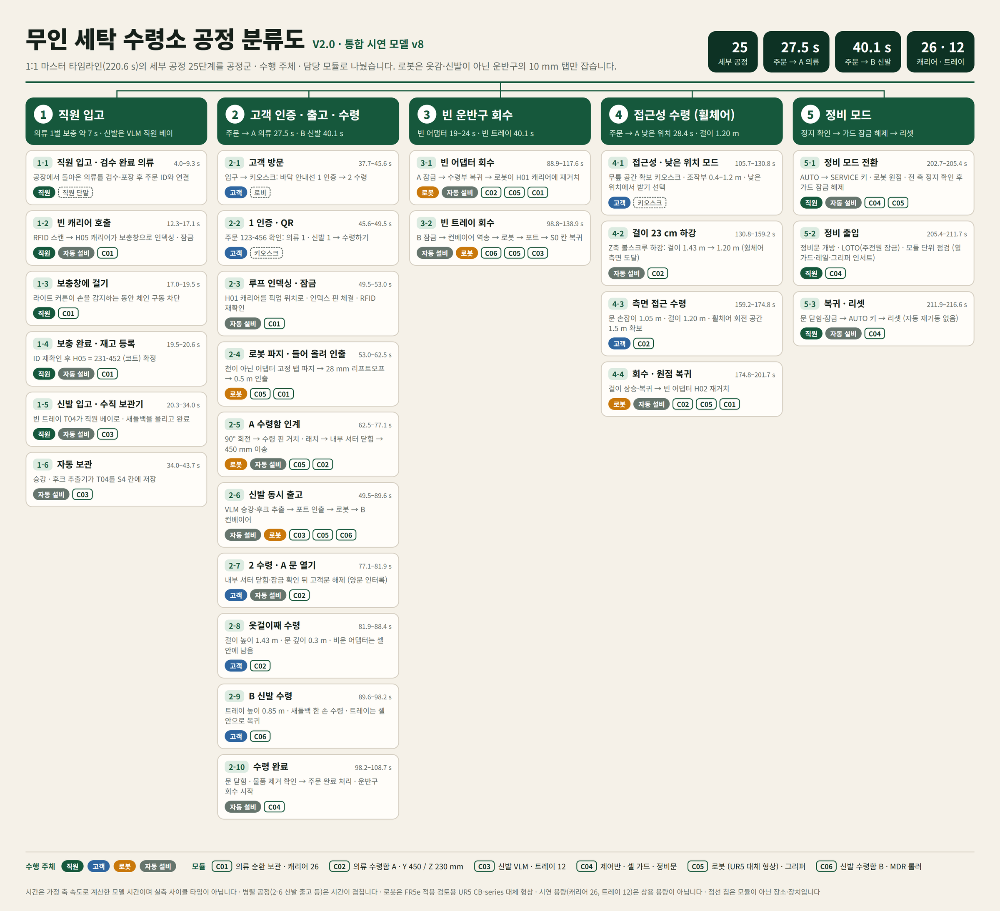
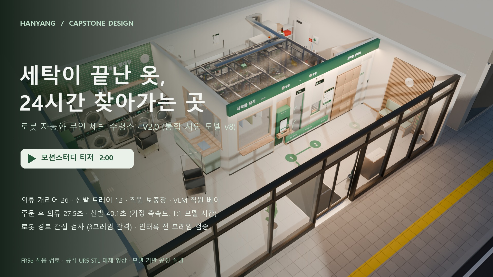

<p align="center">
  
</p>

<p align="center"><b>한국어</b> · <a href="README.en.md">English</a></p>

# 무인 세탁물 수령 시스템 (Automated Unmanned Laundry Pickup System)

한양대학교 캡스톤디자인 프로젝트예요. 세탁이 끝난 옷과 신발을 자동화 셀이 보관하고 있다가, 인증한 고객에게 24시간 내주는 무인 세탁 수령소를 Blender로 설계했어요.

출발점은 단순했어요. 직원이 직접 건네주지 않아도 고객이 세탁물을 찾아가게 하고 싶었어요. 그러려면 맞는 물건이 맞는 사람에게 나와야 하고, 직원이 넣을 때나 고객이 꺼낼 때나 손이 움직이는 기계에 닿으면 안 되고, 옷걸이에 거는 옷과 한 켤레씩 담는 신발을 한 셀에서 같이 다뤄야 했어요.

먼저 말해 둘 것: 이건 **시각·기하·동작 설계 컨셉**이에요. 실제로 만들거나 인증받은 기계가 아니고, 시간은 전부 가정한 축 속도로 계산한 모델 시간이에요. 로봇도 목표 기종인 FR5e 대신 UR5 CB-series 메시를 대체 형상으로 썼어요.

## 최신: 졸업작품 PoC, 2.5 m 셀 (2026-11)

V2.0 매장에서 옷 내주는 공정만 떼어서 2.5 m × 2.5 m 알루미늄 프로파일 셀 하나로 줄인 버전이에요. UR5e와 DH-Robotics AG-95 그리퍼를 쓰고, 옷을 보관해서 로봇에게 가져다주는 방식만 바꾼 4가지 안을 만들어 봤어요.

<p align="center"></p>
<p align="center"><sub>A안, 앞 왼쪽에서 본 셀 전경 (Blender Cycles 렌더)</sub></p>

- **A안** 오버헤드 컨베이어: 옷걸이째 매달아 순환시켜요. 캐리어 10개, 고객 수령까지 46.9 s.
- **B안** 트레이 선반: 접은 옷을 트레이에 담아 로봇 뒤 선반(10칸)에 둬요. 38.1 s.
- **C안** 중앙 로봇: 3면 트레이 선반 30칸과 픽업 벨트. 약 32.0 s.
- **D안** 서랍식 선반: 얇은 트레이 135칸에 QR 확인까지. 빈 트레이 복귀까지 65.7 s.

시간은 끝나는 지점이 안마다 달라서 그대로 비교하면 안 돼요. A안은 Creo로 파트 17종, 컴포넌트 223개를 조립해 셀 사이클 524샘플에서 간섭 0건을 확인했어요. C안은 전체 사이클에서 0건이고, D안은 대표 15칸만 검사했고 나머지 120칸은 경로 계획만 해 뒀어요. A안과 C안은 Creo 2D 도면도 냈어요(예: [셀 배치도 PDF](poc_2.5m_cell/drawings/CV_CELL_LAYOUT.pdf)). B·C·D안의 선반과 트레이는 아직 Blender 개념 모델이고, 옷걸이 순환과 트레이 선반을 합친 하이브리드 안은 만드는 중이에요. 수치와 도면은 [poc_2.5m_cell/README.md](poc_2.5m_cell/README.md)에 다 정리해 뒀어요.

## V2.0: 매장 전체

V2.0은 셀만 그리지 않고 매장 하나를 통째로 설계했어요. 10.5 × 7.5 m 실내를 고객 로비, 셀프 빨래방, 자동화 셀, 직원 공간으로 나눴고, 직원·고객·휠체어 사용자가 움직이는 모습까지 하나의 1:1 타임라인(6,620프레임, 220.6초)에 담았어요. 사람과 기계가 만나는 곳은 양문 수령함 2개와 라이트 커튼이 달린 보충구 2개뿐이에요. 세탁·건조, 옷걸이에 거는 일, 검수·포장은 일부러 사람 일로 남겼어요. 기계가 맡는 건 보관하고 내주는 부분까지예요.

흐름은 이래요.

1. 직원이 검수·포장한 옷을 보충창에서 RFID로 찍고 빈 캐리어에 걸어요. 신발은 수직 보관기(VLM)가 내보낸 빈 트레이에 새들백을 올려요. 라이트 커튼에 손이 걸려 있는 동안은 기계가 멈춰요.
2. 고객이 키오스크에서 QR이나 수령번호로 인증하면 옷과 신발 준비가 동시에 시작돼요.
3. 로봇은 옷감이나 신발을 직접 잡지 않고, 운반구에 달린 10 mm 탭만 잡아요. 옷은 28 mm 들어 올려 핀에서 빼고 0.5 m 꺼낸 다음 A 수령함으로 옮겨요. 신발은 컨베이어로 B 수령함까지 가요.
4. 내부 셔터가 닫히고 잠겨야 고객 쪽 문이 열려요. 주문부터 옷 준비까지 27.5 s, 신발은 40.1 s예요.
5. 고객은 옷걸이째 옷과 새들백만 가져가고, 빈 어댑터와 트레이는 알아서 제자리로 돌아가요.

셀 안은 여섯 모듈로 나눴어요. 옷은 C01 수평 체인 루프에 캐리어 26개로 돌면서 보관되고, 신발은 C03 VLM에 트레이 12개로 쌓여요. C02·C06이 고객 수령함 A(옷)·B(신발), C04가 제어반, C05가 로봇과 그리퍼예요. 모듈마다 자기 프레임이 있어서 통째로 바꿀 수 있게 했어요.

휠체어 사용자는 "낮은 위치에서 받기"를 고르면 걸이가 23 cm 내려와 1.20 m에서 받을 수 있어요(주문부터 28.4 s). 키오스크 아래에 무릎 공간을 두고, 조작부는 0.4–1.2 m, 수령함 앞에는 지름 1.5 m 회전 공간을 비워 뒀어요. 정비는 SERVICE 키로 로봇을 원점에 두고 전 축이 멈춘 걸 확인한 뒤에야 가드가 풀리고, 들어가기 전에 주차단기에 개인 자물쇠(LOTO)를 걸어요. 자동 재기동은 없어요.

안전 쪽은 ISO 10218, ISO 13857, ISO 14119, ISO 14120, ISO 13856-2, IEC 60204-1을 참고해서 설계 의도를 잡은 정도예요. 위험성 평가나 적합성 확인을 한 건 아니에요.

<p align="center"></p>
<p align="center"><sub>공정 분류도: 공정군 5개, 세부 공정 25단계, 단계마다 누가(직원·고객·로봇·자동 설비) 어느 모듈에서 하는지</sub></p>

세부 공정마다 뽑은 렌더 42장은 [docs/v2.0_process_images.md](docs/v2.0_process_images.md)에, 모듈 분해도 8장은 [docs/v2.0_exploded_views.md](docs/v2.0_exploded_views.md)에 있어요.

### 2분 티저

타임라인에서 15개 샷을 잘라 2분짜리 영상으로 만들었어요. 한국어 합성 내레이션이 들어가 있고, 대기 구간만 조금 빨리 돌렸어요(화면에 배속 표시가 붙어요).

[](videos/process_v2.0_teaser_120s_1080p30.mp4)

**[V2.0 티저 보기](videos/process_v2.0_teaser_120s_1080p30.mp4)** · 2:00 · 1080p · [한국어 자막](videos/process_v2.0_ko.srt) · [샷별 설명](docs/v2.0_teaser.md)

GitHub은 README 안에서 MP4를 재생하지 않아서, 포스터를 누르면 파일 페이지로 가요. 거기서 내려받아 보면 돼요.

## 만들면서 고생한 것

검사는 저장한 모델을 다시 열어서 프레임을 직접 평가하는 방식으로 했고, 자동 검사 7개를 다 통과했어요. 인터록 논리는 6,620프레임 전체에서 위반 0, 로봇 간섭은 1,004프레임에서 0이에요. 옷걸이·트레이·새들백은 언제나 캐리어, 로봇, 수령부, 사람 손 중 한 곳에만 붙어 있게 했는데, 31번 주고받는 동안 위치가 튄 건 최대 0.78 mm였어요. 사람 모형도 걸을 때 발이 미끄러지지 않는지(0.00 mm), 손이 잡을 곳에 정확히 닿는지까지 확인했어요. 다만 이건 Blender 안의 형상과 논리 상태만 본 거라, 실제 하중이나 센서 응답, 안전 회로 성능은 검사 대상이 아니에요.

설계에서 제일 오래 붙잡은 건 옷을 빼는 방법이었어요. 옷은 레일에 직각으로 걸려 있어서 휠 끝에서는 이웃한 옷들이 부채꼴로 벌어져요. 그래서 끝단에서 탭을 잡고 살짝 들어 올린 뒤 반지름 방향으로 빼면 이웃 옷의 바깥쪽을 지나가게 했어요. 옷 어댑터와 신발 트레이가 똑같은 10 mm 스테인리스 탭을 쓰게 한 것도 그리퍼 하나로 둘 다 다루려고 정한 거예요.

처음부터 그렇게 깔끔하진 않았어요. 초기 경로에서는 로봇 팔이 A 수령함 모서리 기둥을 뚫고 지나갔어요. 역기구학에서 팔꿈치가 위로 가는 해를 우선하고, 셔터 앞 후퇴 거리를 0.16 m에서 0.40 m로 늘리고 나서야 간섭이 0이 됐어요. 영상에서는 직원이 카메라 위치를 지나가면서 0.5초쯤 인형 속이 비치는 검은 화면이 섞인 적도 있어서, 카메라와 사람 사이 거리를 프레임마다 재는 검사를 따로 만들었어요. 키오스크 화면에 앞 고객의 주문번호가 그대로 떠 있던 것도 나중에 고쳤어요. 걸이가 내려가는 동작은 셔터 뒤에서 일어나 밖에서 안 보여서, 기구를 옮기는 대신 수령함 라이너 하나만 숨긴 단면 카메라로 보여 주고 화면에 단면이라고 적어 뒀어요.

모든 축과 신호는 `V8_CTRL`이라는 제어 리그 하나의 속성으로 움직이게 했어요. 드라이버 223개가 전부 단순식이라 Python 자동 실행 없이도 돌아가요. 자세한 기준과 고친 문제는 [검증 기록](docs/v2.0_verification.md)에 있어요.

## 자료 보는 법

설치할 건 없어요. 브라우저로 보면 되고, 자막까지 보려면 SRT를 불러올 수 있는 플레이어가 있으면 돼요.

```bash
git clone https://github.com/lsy041015/capstone-design-hanyang-university.git
cd capstone-design-hanyang-university

# 예: mpv에서 한국어 자막을 붙여 V2.0 티저 재생
mpv --sub-file=videos/process_v2.0_ko.srt videos/process_v2.0_teaser_120s_1080p30.mp4
```

더 깊이 보고 싶다면 [공정 설계서](docs/v2.0_process_design.md)(배치, 모듈, 순서, 시간, 안전, 정비)부터 보면 돼요. 설계 신호 52개, 부품·정비 목록, 제어 속성은 `docs/`의 CSV 파일에 있어요. 이전 버전 v7 문서는 [docs/v7_overview.md](docs/v7_overview.md)에, v7·v4 영상은 `videos/`에 그대로 남겨 뒀어요. v7은 셀만 다룬 모델이라 수치가 V2.0과 달라요.

## 아직 아닌 것

실물로 가려면 할 일이 많아요. 실제 FR5e CAD로 경로를 다시 검증하고, 체인·벨트·그리퍼를 하중과 토크로 고르고, PLC와 안전 회로를 만들어 시험해야 해요. 옷은 강체로 근사했고, 사람 모형은 동선 확인용 인형이고, 결제·QR·재고 서비스는 화면과 논리 조건만 있어요. 시연 용량(옷 26벌, 신발 트레이 12개)도 상용 매장의 용량이나 수익성을 뜻하지 않고, 저장소에 시장 조사나 비용 분석 자료는 없어요. 그리고 편집 가능한 `.blend` 파일과 생성 스크립트는 올리지 않아서, 이 저장소만으로는 모델을 열거나 검사를 다시 돌릴 수 없어요.

## 출처

- 로봇 형상은 Universal Robots의 공식 UR5 CB-series STL이에요([ROS 2 Description](https://github.com/UniversalRobots/Universal_Robots_ROS2_Description/tree/89bbe795f38a7ab00fb66fe8831dfff79dc99edf/meshes/ur5/collision), 커밋 `89bbe795`). BSD-3-Clause 고지는 [docs/UR5_LICENSE.txt](docs/UR5_LICENSE.txt)에 있고, 이 메시에만 해당해요. UR5 사양을 FR5e 성능 자료로 읽으면 안 돼요.
- 내레이션은 Windows Microsoft Heami Desktop 합성 음성, 배경음은 NumPy로 직접 합성했어요.
- 저장소 전체에 적용되는 라이선스 파일은 없어요.

---

<p align="center"><sub>LSY.KOR · <a href="https://github.com/lsy041015">다른 프로젝트 보기</a></sub></p>
