# PoC 2.5 m 셀: 무인 세탁물 수령 (UR5e, 오버헤드 컨베이어와 트레이 선반 3안)

> **EN:** A 2.5 m x 2.5 m aluminium-profile proof-of-concept cell for the garment pickup step of V2.0: a UR5e with a DH-Robotics AG-95 adaptive gripper. Variant A takes a hanger by its tab from a self-designed overhead conveyor (10 carriers, GT2 belt, 3D-printed track) and lays it on a 0.8 m shelf. Variants B, C and D store folded garments in trays instead: B on a 2 x 5 rack behind the robot, C with the robot at the cell centre and three racks (30 slots) plus a pickup belt, D with thin file-drawer trays (135 slots, QR check, empty tray put back). Creo parts/assembly/drawings (conveyor and C-variant racks), STEP/STL, BOM and Blender photo renders are here. Interference checks: 0 hits in the sampled cycles of A, C and D (D: 15 representative slots only); no result recorded for B.

캡스톤 V2.0 매장의 의류 출고 공정만 2.5 m × 2.5 m 알루미늄 프로파일 셀 하나로 줄인 졸업작품 PoC입니다.
실사용 설비가 아닙니다. 시간은 가정 축 속도로 계산한 모델 시간이고, 안전 기능은 인증 설계가 아닙니다.

## 구성안 4가지 한눈에 보기

같은 셀(2.5 × 2.5 m, UR5e, AG-95, 앞면 픽업 개구부)에서 옷을 보관해 로봇에게 가져다주는 방식만 바꾼 4안입니다.
A안이 처음 설계한 원안이고, B·C·D안은 접은 옷을 트레이에 담는 변형입니다.

| 안 | 보관 방식 | 용량 | 로봇 위치 | 수령 방식 | 1사이클 (모델 시간) | 자세한 곳 |
|---|---|---|---|---|---|---|
| A 오버헤드 컨베이어 | 옷걸이째 매달아 순환 | 캐리어 10개 | 받침대 (0.45, -0.62) m | 0.8 m 선반에 옷걸이째 거치 | 46.9 s (고객 수령까지) | [1-5장](#1-구성-a안) |
| B 트레이 선반 | 접은 옷을 트레이에 담아 로봇 뒤 선반에 보관 | 2열 × 5단 = 10칸 | A안과 같음 | 0.8 m 선반에 트레이째 거치 | 38.1 s (고객이 꺼낼 때까지) | [6장](#6-b안-트레이-선반) |
| C 중앙 로봇 | 셀 중앙 로봇, 좌·뒤·우 3면 트레이 선반 | 3면 × 2열 × 5단 = 30칸 | 셀 중앙 | 픽업 벨트가 앞면 개구부까지 이송 | 약 32.0 s (고객이 꺼낼 때까지) | [7장](#7-c안-중앙-로봇) |
| D 서랍식 선반 | 얇은 트레이를 서랍처럼 꽂는 선반 + QR 확인 | 3면 × 3열 × 15단 = 135칸 | 셀 중앙 | C안과 같은 벨트, 빈 트레이는 되돌려 꽂음 | 65.7 s (슬롯 R1-09, 빈 트레이 복귀까지) | [8장](#8-d안-서랍식-선반) |

사이클 시간은 끝나는 지점이 서로 달라 그대로 비교할 수 없습니다. 출처는 각 안의 `timeline_events*.json`과 Blender 타임라인 길이입니다.

## 1. 구성 (A안)

| 항목 | 내용 |
|---|---|
| 셀 | 40×40 프로파일 2.5 × 2.5 × 2.2 m. 바깥면 아크릴 5 mm. 오른쪽 면에 정비문(0.8 m, 인터록) |
| 로봇 | UR5e (공식 ROS 2 Description 메시, BSD-3). 받침대 0.9 m, 위치 (0.45, -0.62) m |
| 그리퍼 | DH-Robotics AG-95 적응형 전동 그리퍼(행정 95 mm, 45–160 N/조, 권장 하중 3 kg, 1.0 kg, 개폐 0.9 s). 제조사 공식 URDF와 STL 메시를 그대로 사용([DH-Robotics/dh_gripper_ros](https://github.com/DH-Robotics/dh_gripper_ros), `package.xml` BSD). 링크 5종은 URDF의 mimic 비율로 연동. 기본 핑거로 옷걸이 목의 주황 탭(4 mm)을 잡음(조인트 0.615 rad). TCP는 플랜지에서 190 mm |
| 컨베이어 | 타원 루프(직선 1.0 m + 끝 R400), 둘레 4.513 m, 캐리어 10개, 피치 451 mm. 핀 높이 1.65 m |
| 수령 | 앞면 아크릴 개구부 1.0 × 0.35 m. 선반 높이 0.80 m(휠체어 접근 높이). 안쪽 0.45 m + 바깥 0.15 m |
| 주문 | 스마트폰 앱 또는 셀 앞면 갤럭시 탭(벽 거치)에서 인증 |
| 안전 | 개구부 바깥쪽 라이트 커튼(로봇은 이 면을 넘지 않음), E-stop, 신호탑, 정비문 인터록 |

## 2. 시나리오 (A안, 1사이클 46.9 s, Blender 1:1 타임라인)

| 시간 (s) | 단계 |
|---|---|
| 0.0–2.0 | 앱/탭에서 주문 #0427 (G06) 인증 |
| 2.0–7.5 | 컨베이어 인덱싱 1.35 m (3피치, 0.3 m/s, 0.3 m/s²) |
| 7.5–8.0 | 근접센서(트롤리 M3 플래그)·RFID 확인, 정지 |
| 8.0–14.2 | 로봇: 원점 → 탭 앞 60 mm → 직선 진입 → AG-95 닫힘 (0.9 s) |
| 14.2–15.0 | 30 mm 리프트오프 (열린 후크가 핀에서 수직으로 빠짐, 포크 브리지와 4.5 mm 여유) |
| 15.0–19.6 | 반경 방향 인출 0.53 m → 1.75 m로 상승 (밑단이 선반 립 위) |
| 19.6–23.0 | 옷을 로봇 바깥쪽으로 회전 → J1만 47° 선회 (팔과 옷의 상대 위치가 바뀌지 않음) |
| 23.0–33.8 | 선반 위에서 정렬 + 손목 90°(옷을 수평으로) → 하강 → 개구부 쪽으로 밀어 거치 → 16 mm 열어 놓기 |
| 33.8–42.9 | 60 mm 들어 올림 → 완전히 열기 → 후퇴 → 원점 복귀 |
| 42.9–45.9 | 탭에 "수령하세요" 표시 → 고객이 개구부에서 옷걸이째 수령 |

안전 규칙: 로봇이 원점에 있고 라이트 커튼이 정상일 때만 "수령하세요"를 띄웁니다. 커튼이 차단되면 로봇은 선반 구역 동작을 멈춥니다.
컨베이어는 로봇이 원점에 있을 때만 인덱싱합니다.

## 3. 오버헤드 컨베이어 설계 (A안, 모두 자체 제작, Creo)

- **트랙**: 슬롯형입니다. 직선부는 2020 프로파일 2줄(틈 12 mm)이고, 반원부는 PETG 30° 아크 레일(안/밖 각 12개)입니다.
- **U 브리지 28개**: 곡선 15°마다 1개, 직선 중앙에 1개씩 둡니다. 안/밖 레일을 묶고 곡선 아이들러를 달며 M8 로드로 매답니다.
  트롤리 통과 공간(폭 ±36 mm)을 가로지르는 부재가 없습니다.
- **캐리어 10개**:
  - 트롤리 바디는 625ZZ 4개(M5x65 차축 2개)로 레일 위를 구릅니다.
  - 스템이 틈을 지나며, 623ZZ 2개가 틈 안에서 좌우를 안내합니다.
  - 스템 아래 포크에 Ø12 핀 슬리브(M5x40)가 있습니다.
  - 스템 위의 GT2 빗살 조가 벨트를 물어 캐리어와 벨트가 함께 움직입니다.
- **벨트**: GT2 15 mm 오픈 벨트 4.5 m입니다. 양끝은 캐리어 1개의 빗살에 6치씩 물려 이어 붙입니다.
  아래 4 mm 띠는 빗살 조가 물고, 위 10 mm 띠는 롤러가 닿습니다. 아래쪽 플랜지가 없어 조가 모든 롤러 밑을 지나갑니다.
- **곡선 아이들러**: 625ZZ 2단 26세트(15° 간격)입니다. 벨트 처짐은 3.4 mm이며 캐리어에 2.6 N 이하의 횡력을 줍니다.
- **구동**: 뒤쪽 직선에 NEMA17 + 프린트 GT2 40T 풀리를 두고, 625ZZ 백업 롤러로 벨트를 집어(핀치) 구동합니다. 롤러 장공 ±2 mm로 예압을 조정합니다.
- **인덱싱**: LJ12A3-4 근접센서(픽업 위치 -20 mm)와 스텝 수로 맞춥니다. 1 마이크로스텝은 0.025 mm입니다.

| 계산 (가정) | 값 |
|---|---|
| 하중 | 옷 1.5 kg + 캐리어 0.1 kg = 1.6 kg × 10 → 157 N |
| 구름 저항 (μ ≈ 0.02) + 가속 (0.3 m/s², 16 kg) | 3.1 N + 4.8 N ≈ 8 N, 여유 1.5배 → 12 N |
| 풀리 토크 (PD 25.46 mm) | 12 N × 12.7 mm ≈ 0.15 N·m |
| NEMA17 48 mm (보유 토크 약 0.55 N·m, 225 rpm 사용 약 0.35 N·m) | 안전율 약 2.3 |
| 속도 0.3 m/s | 풀리 1회전 80 mm → 225 rpm |
| 프린트 레일 처짐 (지지 간격 105 mm, 30 N 집중) | 0.1 mm 미만 |

### 분해도

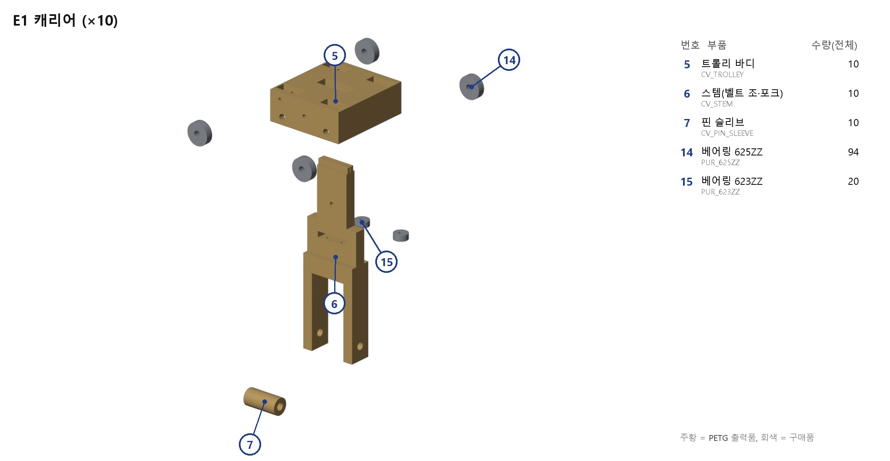 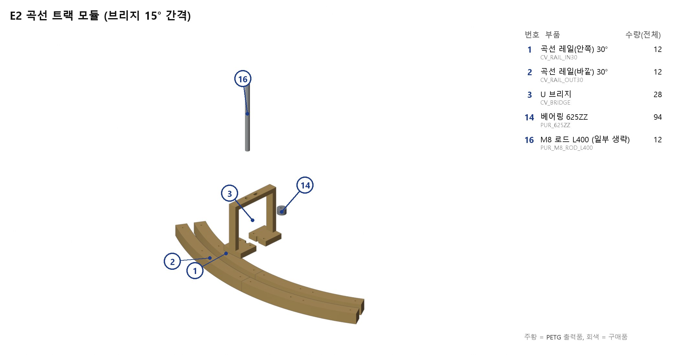

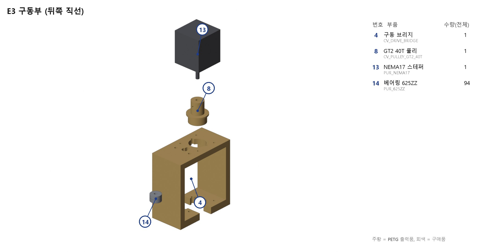 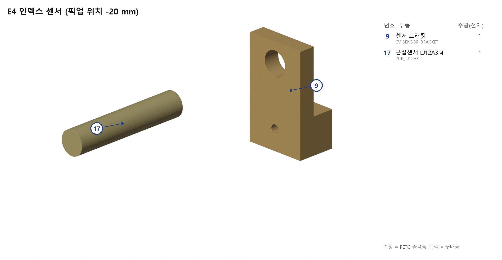

동작 원리와 조립 순서는 [상세설명서 PDF](docs/overhead_conveyor_manual_ko.pdf)에 정리했습니다.

## 4. 검증 (A안)

| 항목 | 결과 |
|---|---|
| Creo 파트 17종 | `design.py` 미리보기와 비교: STL bbox 일치(0.01 mm 이내), 부피 오차 0.34 % 이하, 모두 watertight |
| Creo 어셈블리 `cv_conveyor.asm` | 컴포넌트 223개 배치 (실패 0) |
| 컨베이어 간섭 | 정적 쌍 검사 + 캐리어가 1피치를 10 mm 간격으로 이동하며 스윕 검사 → 0건 |
| 셀 사이클 간섭 | 로봇 7링크 + 그리퍼 + 든 옷 vs 프레임·아크릴·선반·컨베이어·다른 옷, 2프레임 간격 524샘플 → 0건 (DH AG-95 공식 메시 포함) |

검사하지 않은 것:
- 샘플 사이의 순간 접촉, 옷의 유연 변형(강체로 가정), 로봇 자기 충돌, 동역학
- 벨트 실제 장력과 치 건너뜀, 프린트 부품 강도 시험, 안전 기능 성능 수준(PL)과 ISO 13857 거리

## 5. A안 포토 렌더 (Cycles)

A안 장면을 Cycles(256 샘플, OptiX 노이즈 제거)로 다시 그린 사진풍 렌더 8장입니다. 원본 1920 × 1080을 1600 px로 줄였습니다.

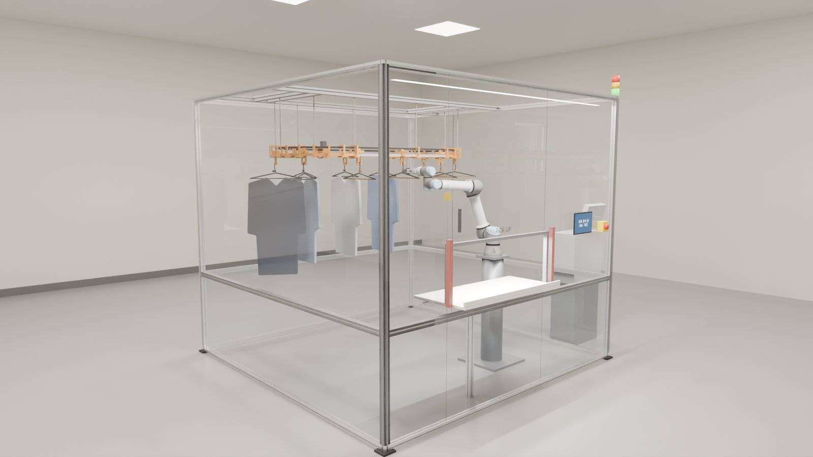

P01 앞 왼쪽에서 본 셀 전경

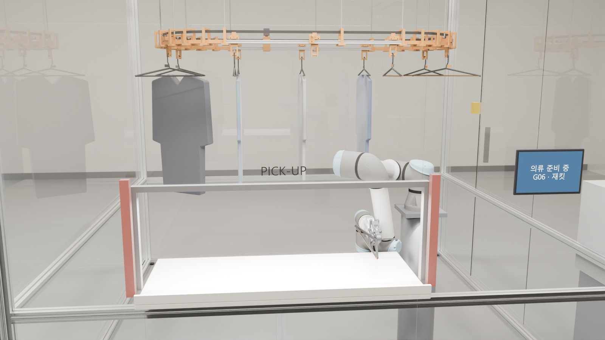 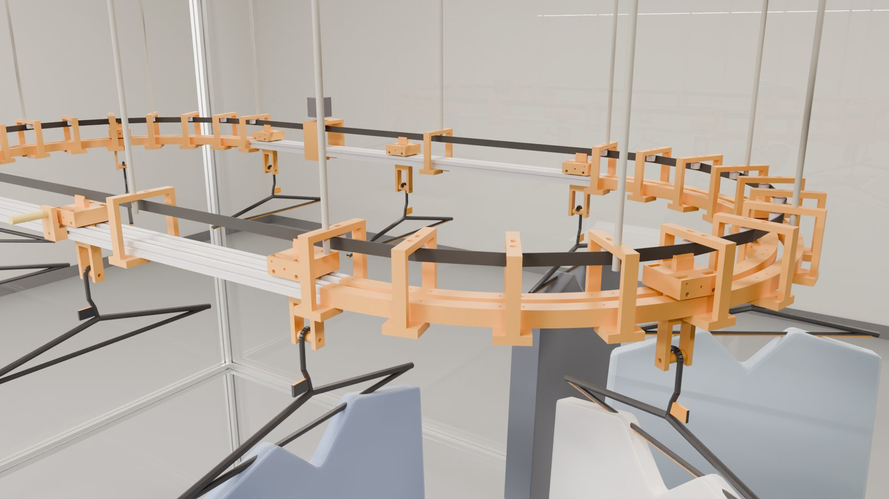

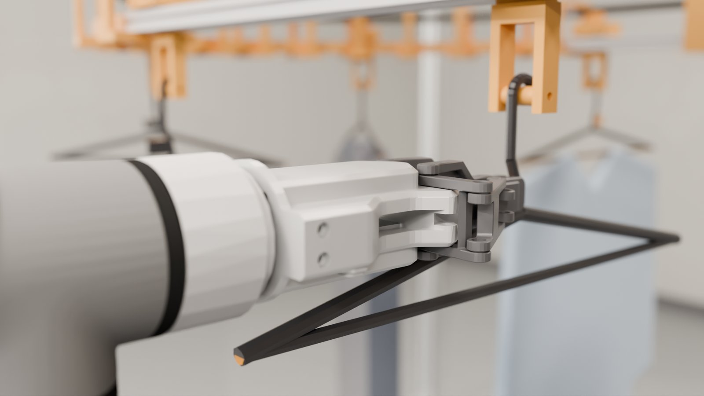 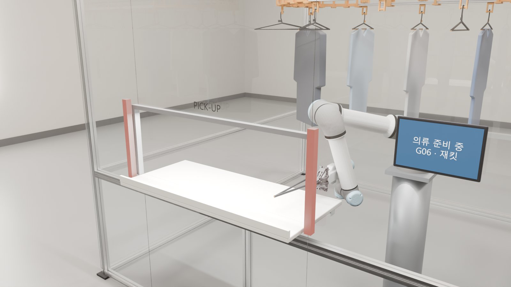

P02 고객 쪽 앞면, P05 컨베이어 안쪽, P06 그리퍼 근접, P08 선반 거치. 나머지 P03(높은 모서리), P04(우측 정비면), P07(구동부)은 `renders/photo/`에 있습니다.

## 6. B안 트레이 선반

오버헤드 컨베이어와 걸린 옷을 없애고, 접은 옷을 담은 트레이를 로봇 뒤 고정 선반(2열 × 5단)에 보관하는 안입니다.
로봇은 트레이 앞의 탭을 잡아 꺼내고 기존 0.8 m 픽업 선반까지 옮깁니다. 출처는 `build_tray.py`와 `timeline_events_tray.json`입니다.

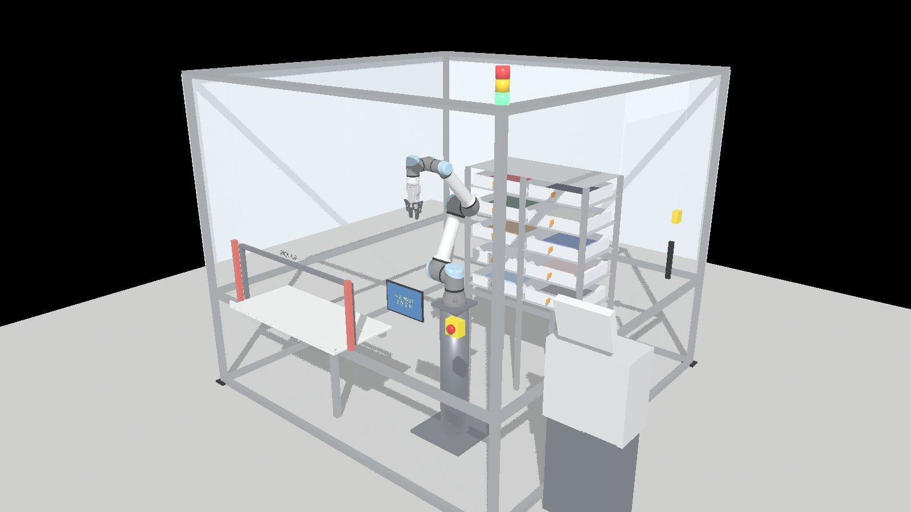

| 항목 | 내용 |
|---|---|
| 선반 | 2열 × 5단 = 10칸. 열 중심 x 0.22 / 0.68 m, 트레이 바닥 높이 0.70–1.42 m (0.18 m 간격). 앞면은 y = 0.08 m로 로봇 축에서 0.70 m |
| 트레이 | 400 × 380 × 80 mm. 앞면에 주황 탭(6 × 40 × 30 mm), 접은 옷 1벌 |
| 로봇 | A안과 같은 받침대 (0.45, -0.62) m, UR5e + AG-95 |
| 주문 | 시나리오는 칸 L-3 (왼쪽 열, 3단) |

1사이클 38.1 s (모델 시간):

| 시간 (s) | 단계 |
|---|---|
| 0.0–2.0 | 앱/탭에서 주문 #0427 (트레이 L-3) 인증 |
| 2.0–10.3 | 로봇 원점 → 손잡이 앞 → 100 mm 직선 진입 → 탭 파지 (닫힘 0.9 s) |
| 10.3–14.4 | 12 mm 들기 → 선반에서 0.50 m 인출 |
| 14.4–21.8 | 150 mm 상승 → 2단계 선회 (셀 안쪽 -X 방향, 그다음 선반 위) |
| 21.8–28.0 | 픽업 선반에 내려놓기 → 그리퍼 열림 → 120 mm 후퇴 |
| 28.0–35.1 | 원점 복귀 |
| 35.1–38.1 | 탭에 "수령하세요" → 고객이 개구부에서 접힌 옷을 꺼냄. 빈 트레이는 선반에 남음 |

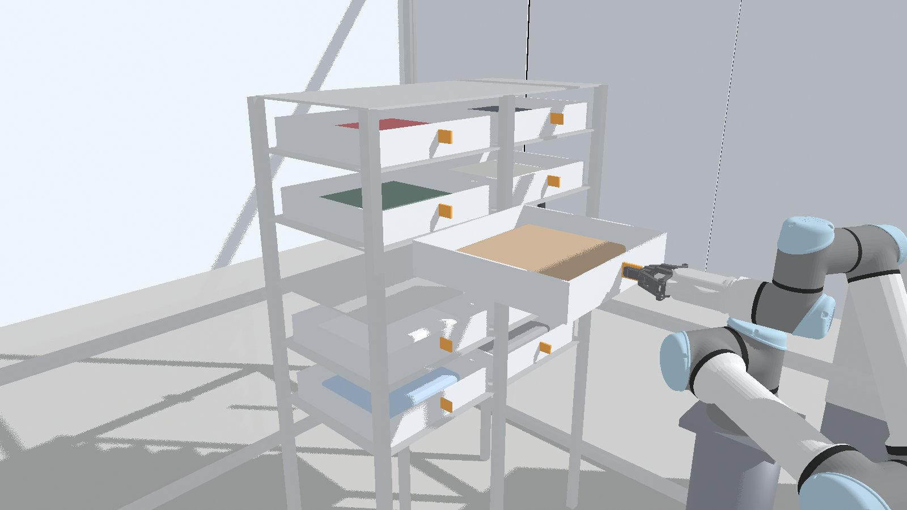 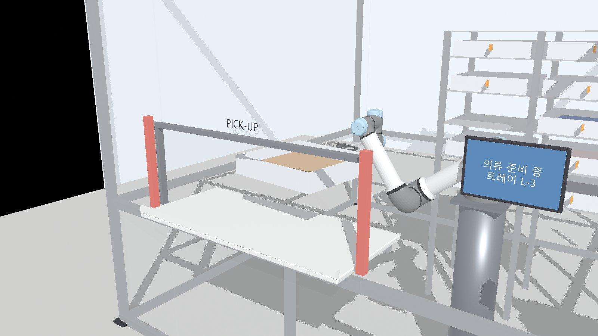

T03 인출, T04 픽업 선반으로 이송. T02(탭 파지)와 T05(고객 수령)도 `renders/tray/`에 있습니다. T 시리즈는 Eevee 작업 렌더 1600 × 900입니다.

이 안은 빈 트레이를 되돌리지 않습니다. 간섭 검사 결과는 저장소에 남기지 않았습니다(스크립트에는 `check()`가 있음).

## 7. C안 중앙 로봇

로봇을 셀 중앙으로 옮기고, 좌·뒤·우 3면에 트레이 선반을 둔 안입니다. 로봇은 선반에서 트레이를 반경 방향으로 빼낸 뒤 J1만 돌려 픽업 벨트에 올리고,
벨트가 트레이를 앞면 개구부까지 보냅니다. 출처는 `build_center.py`, `timeline_events_center.json`, `conveyor/rack_design.py`입니다.

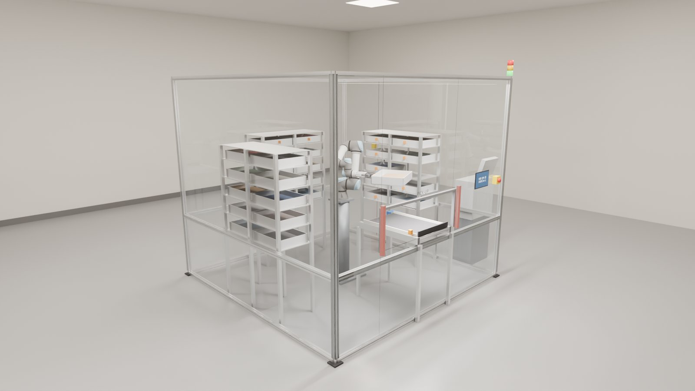

S01 앞 왼쪽에서 본 C안 (Cycles)

| 항목 | 내용 |
|---|---|
| 로봇 | UR5e 받침대 Ø180 H900, 셀 중앙 (0, 0) |
| 선반 | 좌(L)·뒤(B)·우(R) 3면 × 2열 × 5단 = 30칸. 앞면(트레이 앞벽)은 로봇 축에서 R820, 열 중심 ±220 mm, 단 높이 0.70–1.42 m (180 mm 간격) |
| 트레이 | 400 × 320 × 80 mm, PETG. 탭 6 × 40 × 30 mm. 인출 거리 0.36 m |
| 픽업 벨트 | 450 × 660 mm, 상면 FL+800 (개구부 하단 높이), 끝단 스톱·광센서, 0.15 m/s |
| 주문 | 시나리오는 칸 R1-3 (오른쪽 선반, 1열, 3단) |

1사이클 약 32.0 s (고객이 꺼낼 때까지, 모델 시간):

| 시간 (s) | 단계 |
|---|---|
| 0.0–2.0 | 앱/탭에서 주문 #0427 (트레이 R1-3) 인증 |
| 2.0–10.3 | 원점 → 손잡이 앞 → 100 mm 직선 진입 → 탭 파지 → 12 mm 들기 |
| 10.3–13.9 | 반경 방향으로 0.36 m 인출 → 120 mm 상승 |
| 13.9–15.4 | J1 단독 선회 -63° (벨트 쪽, 트레이는 팔 바깥쪽에 그대로) |
| 15.4–22.2 | 벨트 투입 위치 위로 → 내려놓기 → 그리퍼 열림 |
| 22.2–29.0 | 150 mm 수직 후퇴 → 원점 복귀. 벨트가 0.25 m 이송해 끝단 센서에서 정지 (23.2–24.9) |
| 29.0–32.0 | 탭에 "수령하세요" → 고객이 개구부에서 옷을 꺼냄 |

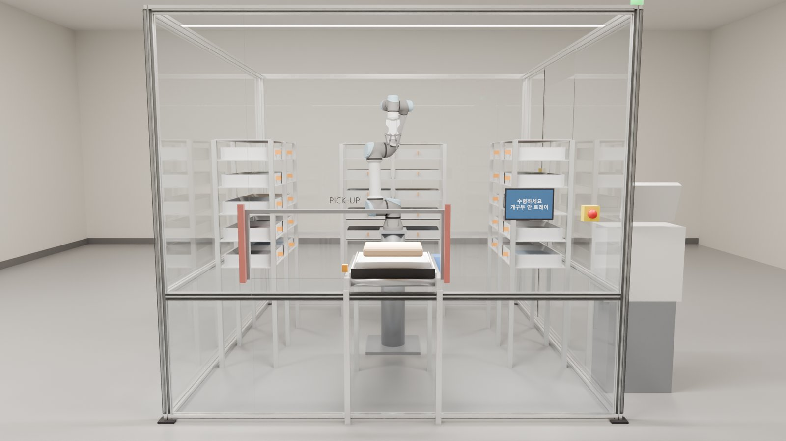 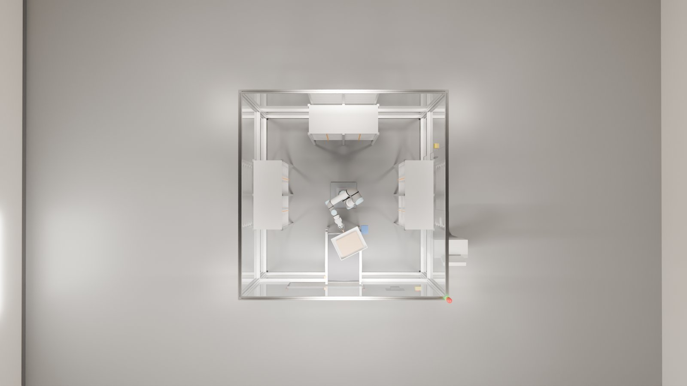

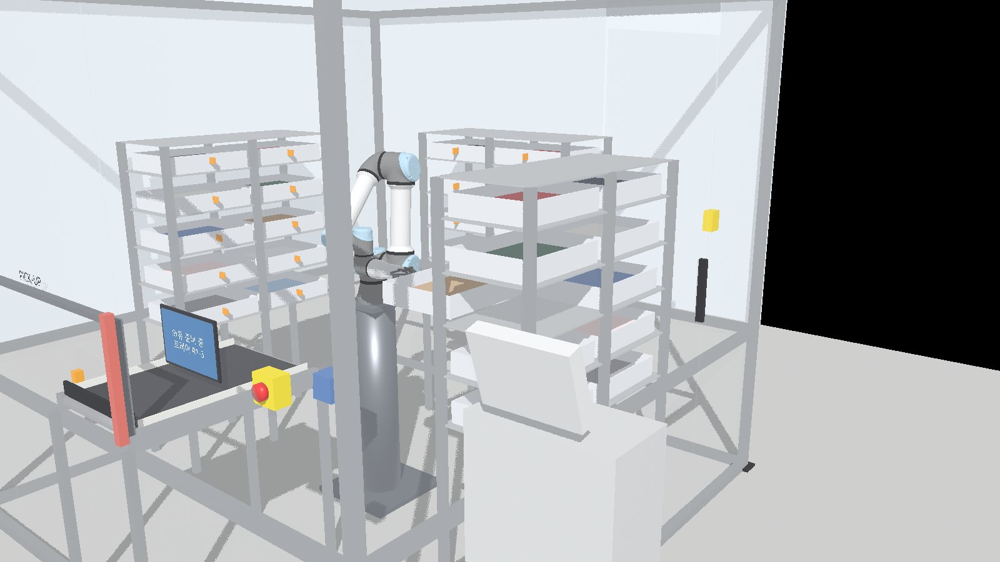 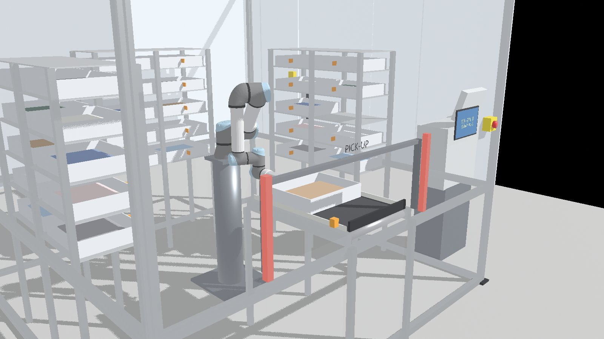

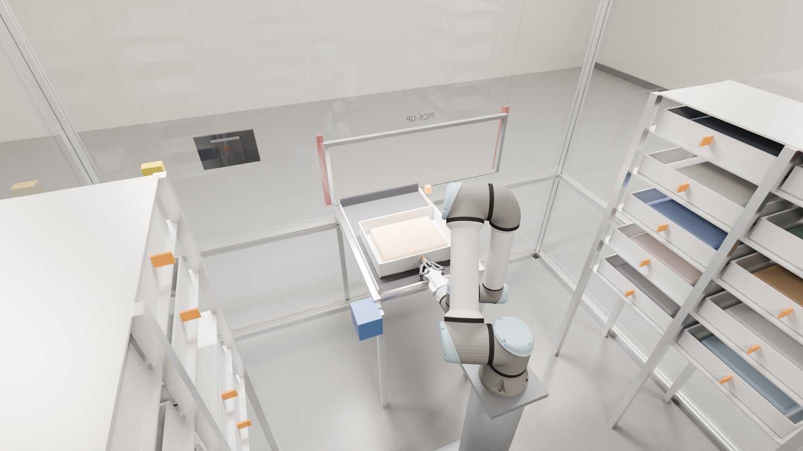 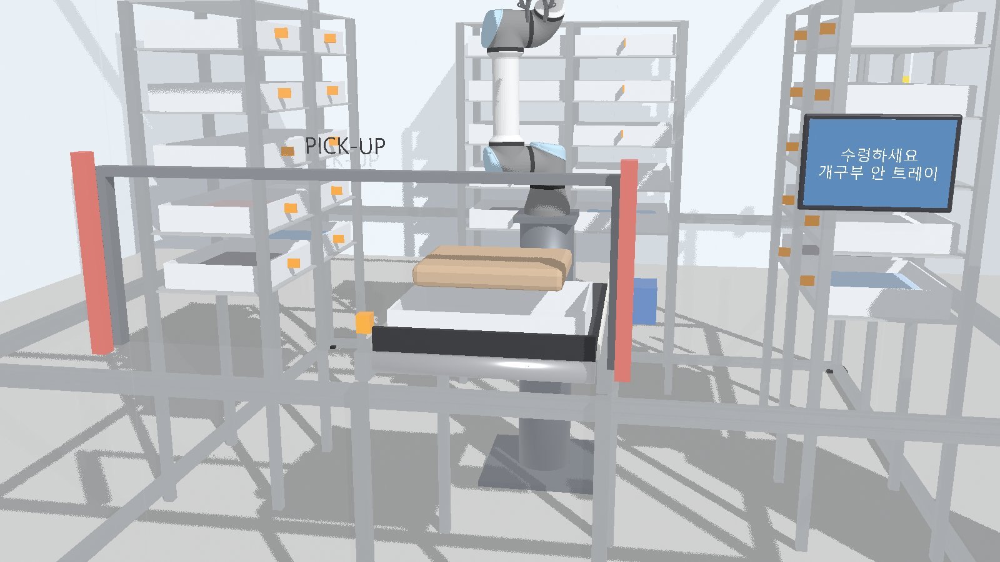

S02·S04·S08은 Cycles 포토, C03–C05는 Eevee 작업 렌더입니다. 나머지 S03·S05·S06·S07과 C01·C02는 `renders/center_photo/`, `renders/center/`에 있습니다.

검증: 로봇 7링크 + 그리퍼 + 든 트레이를 프레임·아크릴·안전기기·받침대·선반·벨트와 BVH로 겹침 검사했습니다. 주문 접수 뒤 고객 수령까지 사이클 전체(2프레임 간격)에서 0건입니다.
트레이가 자기 선반이나 벨트 위를 미끄러지는 구간은 검사에서 제외했습니다.
타임라인 문구에는 "빈 트레이는 역송 후 로봇이 선반으로 회수"라고 적었지만, 이 회수 동작은 C안 애니메이션과 검사에 들어 있지 않습니다(D안에서 구현).

## 8. D안 서랍식 선반

C안에서 선반을 파일 서랍처럼 바꿔 칸 수를 늘린 안입니다. 얇은 트레이를 70 mm 간격으로 꽂고, 로봇은 그리퍼 카메라로 QR을 확인한 뒤 서랍처럼 빼냅니다.
고객이 옷을 가져가면 빈 트레이를 벨트로 되돌려 받아 같은 칸에 다시 꽂습니다. 출처는 `build_files.py`와 `timeline_events_files.json`입니다.

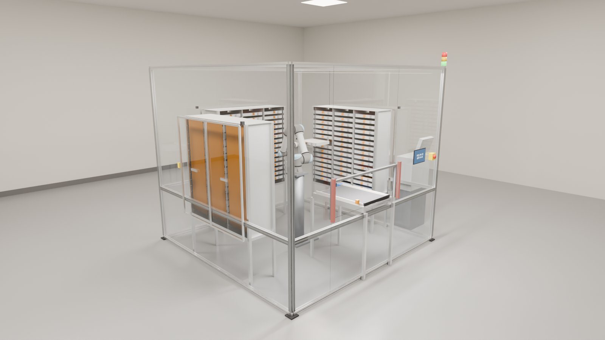

F01 앞 왼쪽에서 본 D안 (Cycles)

| 항목 | 내용 |
|---|---|
| 선반 | 좌·뒤·우 3면 × 3열 × 15단 = 135칸. 열 중심 ±0.37 m, 앞면 R880, 단 간격 70 mm (트레이 45 + 러너 4 + 들기 12 + 여유 9), 러너 상면 높이 0.57–1.55 m |
| 트레이 | 340 × 280 × 45 mm 얇은 트레이 (접힌 옷 300 × 240 × 30 기준). 앞 탭 40 mm, 앞면에 QR 라벨 |
| 인식 | AG-95 옆 툴 플랜지에 QR 카메라. 렌더의 QR은 읽히지 않는 모양 텍스처입니다 |
| 적재 | 직원은 랙 뒤쪽 아크릴의 인터록 해치로 트레이를 밀어 넣고, 후면 스프링 래치를 지나면 걸립니다 |
| 픽업 | C안과 같은 벨트 450 × 660 mm, FL+800. 벨트 끝 쪽 로드셀이 빈 트레이를 확인 |
| 낮은 단 | 단이 낮을수록 공구를 최대 35°까지 아래로 기울여 접근 |

1사이클 65.7 s (슬롯 R1-09 = 오른쪽 선반 1열 9단, 모델 시간, Blender 타임라인 길이). 순서는 다음과 같습니다.

| 순서 | 단계 |
|---|---|
| 1 | 주문 접수 → 서버가 슬롯 지정 |
| 2 | 랙 중앙 앞으로 이동, 슬롯 앞에서 그리퍼 카메라로 QR 확인 (0.8 s) |
| 3 | 탭 진입 → 파지 → 12 mm 들기 → 서랍처럼 0.34 m 인출 |
| 4 | 선회 높이로 이동 → J1 단독 선회로 벨트 쪽을 향함 → 벨트에 내려놓기 |
| 5 | 벨트가 0.27 m 이송해 픽업존에 정지 → 탭에 "수령하세요" → 고객이 옷을 꺼냄 |
| 6 | 로드셀로 빈 트레이 확인 → 벨트 역송 → 로봇이 빈 트레이를 다시 파지 |
| 7 | J1 역선회 → 서랍처럼 후면 래치까지 밀어 넣기 → 열림 → 후퇴 |
| 8 | QR 재확인으로 빈 트레이 복귀를 기록 → 원점 복귀 |

`timeline_events_files.json`에는 다른 슬롯 B3-15를 계획한 기록(끝 87.7 s)이 들어 있어, 칸에 따라 시간이 달라집니다.

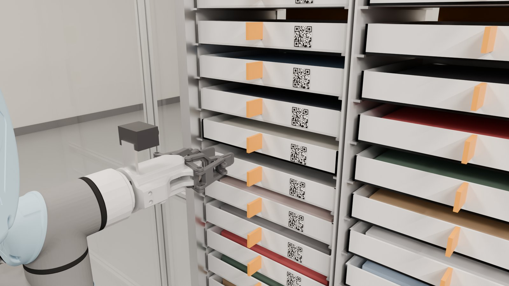 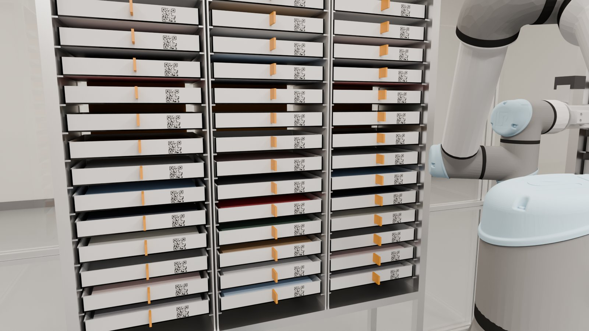

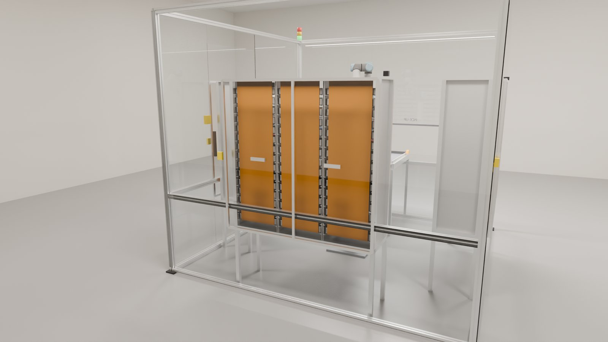 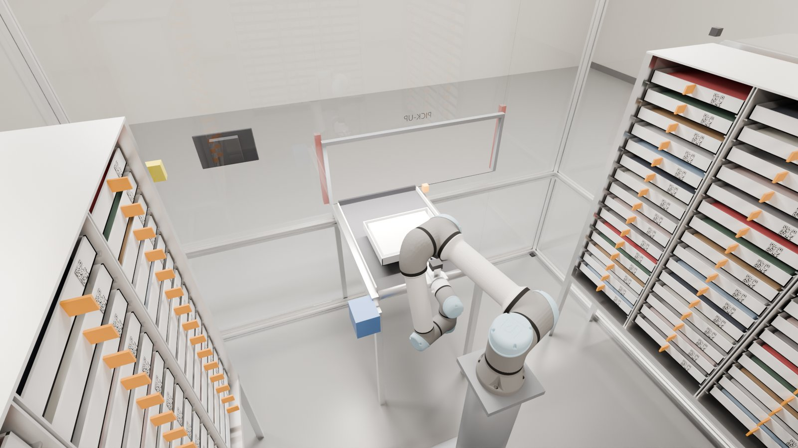

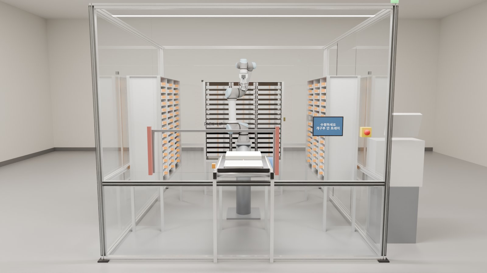 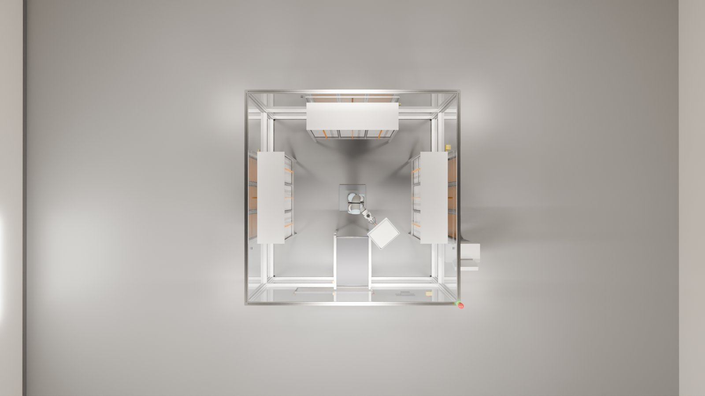

F06 QR 확인, F09 선반 상세, F07 뒤쪽 적재 해치, F08 로봇 위에서, F02 고객 쪽, F04 평면. 나머지 F03·F05는 `renders/files_photo/`에 있습니다.

검증:

| 항목 | 결과 |
|---|---|
| 135칸 경로 계획 | 모든 칸에서 IK와 받침대 여유(팔이 받침대로 접히지 않음) 계획 통과 |
| 전체 사이클 BVH 겹침 검사 | **대표 15칸만** 실행, 0건. 나머지 120칸은 경로 계획만 했고 BVH 검사는 하지 않았습니다 |

## 9. A안과 중앙 로봇안(C·D) 비교

어느 쪽이 낫다고 결론 내리지 않고, 모델에서 확인한 차이만 적습니다.

| 항목 | A 오버헤드 컨베이어 | C·D 중앙 로봇 + 트레이 선반 |
|---|---|---|
| 옷 상태 | 옷걸이에 건 채로 보관, 접지 않음 | 접어서(압축 포장) 트레이에 담음. 접기·포장 공정은 이 PoC에 없음 |
| 움직이는 기구 | 오버헤드 루프 (벨트 4.5 m, 캐리어 10개, 구동부) | 오버헤드 기구 없음. 움직이는 것은 로봇과 픽업 벨트뿐 |
| 보관 밀도 | 캐리어 10개 | C 30칸, D 135칸 (접힌 옷이라 촘촘함) |
| 옷을 가져오는 쪽 | 컨베이어가 각 옷걸이를 로봇 앞 픽업 위치로 가져옴 | 로봇이 선반의 칸까지 가서 꺼냄. 칸마다 경로 계획이 필요 (D는 135칸 전수 계획) |
| 빈 용기 | 옷걸이째 수령, 회수 동작 없음 | D는 벨트로 되돌려 같은 칸에 다시 꽂음. B·C는 모델에 없음 |

## 10. 중앙 로봇 선반 Creo 도면 (C안)

C안 선반 1대(2열 × 5단)와 셀 전체 배치를 Creo 13.4 교육용 버전에서 모델링하고 ANSI C(22 × 17 in) 도면으로 만들었습니다.
뷰는 Creo에서 3각법으로 생성했고, 치수는 그 뷰 위에 덧그린 주석입니다(A안 도면과 같은 방식).

| 도면 | 내용 | 척도 |
|---|---|---|
| `RK_RACK.pdf` | 선반 1대 조립도: 3030 기둥 6, 선반판 5 + 상판 1, 트레이 10, L브래킷 48, 레벨링 풋 6. Creo 조립품 부품 22개 | 1:10 |
| `RK_SHELF.pdf` | 선반판·상판 겸용. SPCC 1.6 t 판금 900 × 370 mm, 앞·뒤 플랜지 20 mm, 기둥 자리 따냄, 8-Ø6.6 구멍 | 1:5 |
| `RK_TRAY.pdf` | 의류 트레이. PETG 400 × 320 × 80 mm, 벽 6 mm, 그립 탭 6 × 40 × 30 mm (FDM 출력) | 1:2 |
| `RK_POST_3030_L1550.pdf` | 3030 알루미늄 프로파일 기둥 L1550, 양단 M6 탭 | 1:10 |
| `CC_CELL.pdf` | C안 셀 배치도: 평면·정면·우측면, 장비 12종 일람표 (부품 66 + 선반 서브조립 3) | 1:20 |
| `RK_drawings_all.pdf` | 위 5장 묶음 | - |

도면은 [`drawings/rack_center/`](drawings/rack_center/)에 있습니다. 선반 높이는 상면 기준 FL+700 / 880 / 1060 / 1240 / 1420 mm이고, 상판은 FL+1550 mm 기둥 위에 얹습니다.
STEP은 `cad/step/`의 `rk_post_3030_l1550.stp`, `rk_shelf.stp`, `rk_tray.stp`(선반 부품 3종)와 `pc_*.stp`(픽업 벨트 부품 8종: 벨트, 측면 프레임, 가이드, 다리, 롤러, 끝단 스톱, 모터, 센서)입니다.
`pc_*` 부품 대부분은 단순 박스 형상입니다.

## 11. 파일

| 경로 | 내용 |
|---|---|
| `renders/` | A안 정지 렌더 8장 (셀 전경, 컨베이어, 구동부, 파지, 인출·선회, 선반 거치, 고객 수령, DH 그리퍼 근접) |
| `renders/photo/` | A안 Cycles 포토 렌더 8장 (P01–P08) |
| `renders/tray/` | B안 렌더 5장 (T01–T05, Eevee) |
| `renders/center/`, `renders/center_photo/` | C안 렌더 5장 (C01–C05, Eevee), Cycles 포토 8장 (S01–S08) |
| `renders/files_photo/` | D안 Cycles 포토 렌더 9장 (F01–F09) |
| `docs/overhead_conveyor_manual_ko.pdf` | **상세설명서 24쪽**: 동작 원리 도식(평면 배치·트랙 단면·핀치 구동·인덱싱 순서), 분해도, BOM, 설계 계산, 조립 순서, 검증, A3 도면 10장 |
| `exploded/` | 분해도 4장 (E1 캐리어, E2 곡선 트랙 모듈, E3 구동부, E4 인덱스 센서), BOM 번호 풍선 |
| `drawings/CV_CELL_LAYOUT.pdf` | **셀 전체 배치도** (Creo `cv_cell.asm`, ANSI C, 1:20, 3각법: 평면·정면·우측면, 장비 13종 일람표) |
| `drawings/rack_center/` | **C안 선반 도면 6개**: `RK_RACK`(1:10), `RK_SHELF`(1:5), `RK_TRAY`(1:2), `RK_POST_3030_L1550`(1:10), 셀 배치도 `CC_CELL`(1:20), 묶음 `RK_drawings_all.pdf` (ANSI C, 3각법) |
| `drawings/` | 컨베이어 조립도 `CV_CONVEYOR.pdf` (1:10) + 가공품 2D 도면 9장 (A3, 치수·표제란) + 묶음 `CV_drawings_all.pdf` |
| `cad/creo_native/` | Creo 13.4 원본: 컨베이어 파트 17 + 셀 파트 23 + 로봇·그리퍼 STL 가져오기 16 (`imp_*`), 어셈블리 `cv_conveyor.asm`·`cv_cell.asm`·`cv_cell_view.asm`, 도면 |
| `cad/step/cv_cell.stp` | 셀 전체 STEP (프레임·아크릴·컨베이어·로봇 포함) |
| `cad/third_party/` | UR5e 메시 라이선스(BSD-3), DH AG-95 URDF 출처(package.xml BSD) |
| `cad/step/` | 파트별 STEP + 어셈블리 `cv_conveyor.stp`, C안 선반 부품 `rk_*.stp` 3종과 픽업 벨트 부품 `pc_*.stp` 8종 |
| `cad/stl/` | 출력용 STL (`cv_*` 9종 PETG), 구매품 단순 형상 STL |
| `BOM.csv` | 자체 제작 9종 + 구매품 8종 + 체결·전장 부품 (UTF-8 BOM, 엑셀에서 바로 열림) |

Creo 파일은 교육용 버전(Creo 13.4 Educational)에서 만들었으므로 상용 Creo에서는 열리지 않을 수 있습니다. 이때는 STEP을 쓰면 됩니다.
Blender 장면(.blend), 생성·검증 스크립트, 타임라인 JSON은 이 저장소에 올리지 않았습니다. 여기에는 B·C·D안의 .blend와 빌드 스크립트도 포함됩니다.
C안 선반의 Creo 원본(.prt, .asm)도 올리지 않았고, 도면 PDF와 STEP만 있습니다.

## 12. 한계와 다음 단계

- 탭 장착 옷걸이, 라이트 커튼, 컨트롤러 배선은 개념 수준입니다.
- B·C·D안의 선반, 트레이, 벨트, 로드셀, QR 카메라는 Blender에서 단순 형상으로 만든 개념 모델입니다. 트레이 하중, 처짐, 구동 용량 계산은 하지 않았습니다.
- 접힌 옷은 트레이 안의 박스입니다. 옷의 접기·포장 공정과 주름은 다루지 않았고, 옷의 유연 변형은 강체로 가정합니다.
- D안 BVH 겹침 검사는 대표 15칸뿐이고 나머지 120칸은 경로 계획만 했습니다. B안은 검사 결과를 남기지 않았고, C안은 빈 트레이 회수를 검사하지 않았습니다.
- 사이클 시간은 가정 축 속도로 계산한 모델 시간입니다. 안별로 끝나는 지점이 달라 A·B·C·D를 그대로 비교하지 마세요.
- 선반 Creo 도면은 C안만 있습니다. B·D안 선반은 Blender 모델입니다. 도면 치수는 A안 도면과 같이 Creo 뷰 위에 덧그린 주석입니다.
- AG-95 권장 하중 3 kg이라 1.5 kg 재킷에도 여유가 있습니다.
- 그리퍼 형상은 DH 공식 URDF 메시(본체 93 × 67 × 138 mm)입니다. 다만 URDF의 링크 연동은 mimic 근사라서 실제 4절 링크와 조금 다릅니다.
  UR 플랜지 어댑터는 모델에 넣지 않았습니다(본체 바닥을 플랜지에 바로 붙임).
- 선반에서는 손목을 90° 돌린 뒤라 핑거가 세로로 섭니다. 그래서 TCP를 선반 위 80 mm에 두고 16 mm만 벌려 놓은 다음, 60 mm 들어 올린 뒤 완전히 엽니다.
- 도면 치수는 Creo 뷰 위에 덧그린 주석이며 Creo 연관 치수가 아닙니다. 형상 원본은 Creo 파트입니다.
- 실제 제작 전 확인할 것:
  - 벨트 이음부 인장 시험
  - 빗살 조 출력 정밀도(0.12 레이어)
  - 핀치 구동 미끄럼
  - 곡선부 625ZZ가 벨트 치에 닿을 때의 소음
- 옷걸이 순환과 트레이 선반을 합친 하이브리드(옷걸이 + 트레이) 변형안은 제작 중이며 아직 이 문서에 넣지 않았습니다.
