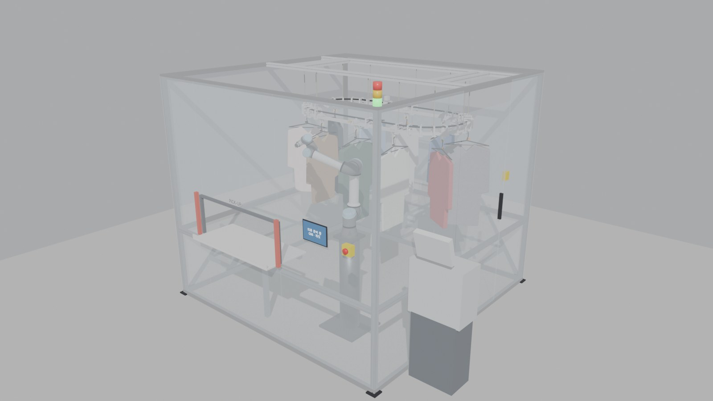
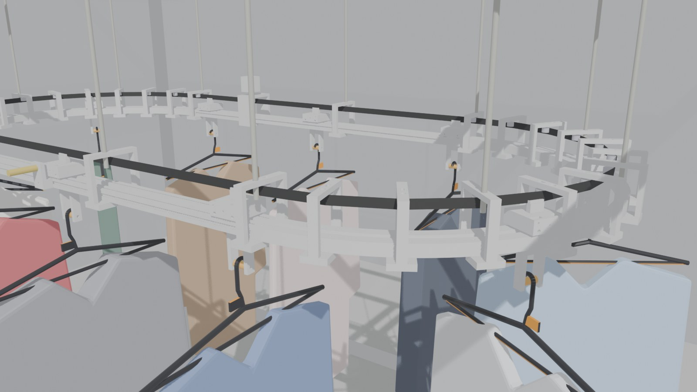

# PoC 2.5 m 셀: 무인 세탁물 수령 (UR5e + 오버헤드 컨베이어)

> **EN:** A 2.5 m x 2.5 m aluminium-profile proof-of-concept cell for the garment pickup step of V2.0: a UR5e with a DH-Robotics AG-95 adaptive gripper takes a hanger by its tab from a self-designed overhead conveyor (10 carriers, GT2 belt, 3D-printed track and carriers) and lays it on a 0.8 m shelf through an acrylic opening. Creo parts/assembly/drawings, STEP/STL and BOM are here; interference checks found 0 hits in the sampled cycle.

캡스톤 V2.0 매장의 의류 출고 공정만 2.5 m × 2.5 m 알루미늄 프로파일 셀 하나로 줄인 졸업작품 PoC입니다.
실사용 설비가 아닙니다. 시간은 가정 축 속도로 계산한 모델 시간이고, 안전 기능은 인증 설계가 아닙니다.

## 1. 구성

| 항목 | 내용 |
|---|---|
| 셀 | 40×40 프로파일 2.5 × 2.5 × 2.2 m. 바깥면 아크릴 5 mm. 오른쪽 면에 정비문(0.8 m, 인터록) |
| 로봇 | UR5e (공식 ROS 2 Description 메시, BSD-3). 받침대 0.9 m, 위치 (0.45, -0.62) m |
| 그리퍼 | DH-Robotics AG-95 적응형 전동 그리퍼(행정 95 mm, 45–160 N/조, 권장 하중 3 kg, 1.0 kg, 개폐 0.9 s). 제조사 공식 URDF와 STL 메시를 그대로 사용([DH-Robotics/dh_gripper_ros](https://github.com/DH-Robotics/dh_gripper_ros), `package.xml` BSD). 링크 5종은 URDF의 mimic 비율로 연동. 기본 핑거로 옷걸이 목의 주황 탭(4 mm)을 잡음(조인트 0.615 rad). TCP는 플랜지에서 190 mm |
| 컨베이어 | 타원 루프(직선 1.0 m + 끝 R400), 둘레 4.513 m, 캐리어 10개, 피치 451 mm. 핀 높이 1.65 m |
| 수령 | 앞면 아크릴 개구부 1.0 × 0.35 m. 선반 높이 0.80 m(휠체어 접근 높이). 안쪽 0.45 m + 바깥 0.15 m |
| 주문 | 스마트폰 앱 또는 셀 앞면 갤럭시 탭(벽 거치)에서 인증 |
| 안전 | 개구부 바깥쪽 라이트 커튼(로봇은 이 면을 넘지 않음), E-stop, 신호탑, 정비문 인터록 |

## 2. 시나리오 (1사이클, 46.9 s, Blender 1:1 타임라인)

| 시간 (s) | 단계 |
|---|---|
| 0.0–2.0 | 앱/탭에서 주문 #0427 (G06) 인증 |
| 2.0–7.5 | 컨베이어 인덱싱 1.35 m (3피치, 0.3 m/s, 0.3 m/s²) |
| 7.5–8.0 | 근접센서(트롤리 M3 플래그)·RFID 확인, 정지 |
| 8.0–14.2 | 로봇: 원점 → 탭 앞 60 mm → 직선 진입 → AG-95 닫힘 (0.9 s) |
| 14.2–15.0 | 30 mm 리프트오프 (열린 후크가 핀에서 수직으로 빠짐, 포크 브리지와 4.5 mm 여유) |
| 15.0–19.6 | 반경 방향 인출 0.53 m → 1.75 m로 상승 (밑단이 선반 립 위) |
| 19.6–23.0 | 옷을 로봇 바깥쪽으로 회전 → J1만 47° 선회 (팔과 옷의 상대 위치가 바뀌지 않음) |
| 23.0–33.8 | 선반 위에서 정렬 + 손목 90°(옷을 수평으로) → 하강 → 개구부 쪽으로 밀어 거치 → 16 mm 열어 놓기 |
| 33.8–42.9 | 60 mm 들어 올림 → 완전히 열기 → 후퇴 → 원점 복귀 |
| 42.9–45.9 | 탭에 "수령하세요" 표시 → 고객이 개구부에서 옷걸이째 수령 |

안전 규칙: 로봇이 원점에 있고 라이트 커튼이 정상일 때만 "수령하세요"를 띄웁니다. 커튼이 차단되면 로봇은 선반 구역 동작을 멈춥니다.
컨베이어는 로봇이 원점에 있을 때만 인덱싱합니다.

## 3. 오버헤드 컨베이어 설계 (모두 자체 제작, Creo)

- **트랙**: 슬롯형입니다. 직선부는 2020 프로파일 2줄(틈 12 mm)이고, 반원부는 PETG 30° 아크 레일(안/밖 각 12개)입니다.
- **U 브리지 28개**: 곡선 15°마다 1개, 직선 중앙에 1개씩 둡니다. 안/밖 레일을 묶고 곡선 아이들러를 달며 M8 로드로 매답니다.
  트롤리 통과 공간(폭 ±36 mm)을 가로지르는 부재가 없습니다.
- **캐리어 10개**:
  - 트롤리 바디는 625ZZ 4개(M5x65 차축 2개)로 레일 위를 구릅니다.
  - 스템이 틈을 지나며, 623ZZ 2개가 틈 안에서 좌우를 안내합니다.
  - 스템 아래 포크에 Ø12 핀 슬리브(M5x40)가 있습니다.
  - 스템 위의 GT2 빗살 조가 벨트를 물어 캐리어와 벨트가 함께 움직입니다.
- **벨트**: GT2 15 mm 오픈 벨트 4.5 m입니다. 양끝은 캐리어 1개의 빗살에 6치씩 물려 이어 붙입니다.
  아래 4 mm 띠는 빗살 조가 물고, 위 10 mm 띠는 롤러가 닿습니다. 아래쪽 플랜지가 없어 조가 모든 롤러 밑을 지나갑니다.
- **곡선 아이들러**: 625ZZ 2단 26세트(15° 간격)입니다. 벨트 처짐은 3.4 mm이며 캐리어에 2.6 N 이하의 횡력을 줍니다.
- **구동**: 뒤쪽 직선에 NEMA17 + 프린트 GT2 40T 풀리를 두고, 625ZZ 백업 롤러로 벨트를 집어(핀치) 구동합니다. 롤러 장공 ±2 mm로 예압을 조정합니다.
- **인덱싱**: LJ12A3-4 근접센서(픽업 위치 -20 mm)와 스텝 수로 맞춥니다. 1 마이크로스텝은 0.025 mm입니다.

| 계산 (가정) | 값 |
|---|---|
| 하중 | 옷 1.5 kg + 캐리어 0.1 kg = 1.6 kg × 10 → 157 N |
| 구름 저항 (μ ≈ 0.02) + 가속 (0.3 m/s², 16 kg) | 3.1 N + 4.8 N ≈ 8 N, 여유 1.5배 → 12 N |
| 풀리 토크 (PD 25.46 mm) | 12 N × 12.7 mm ≈ 0.15 N·m |
| NEMA17 48 mm (보유 토크 약 0.55 N·m, 225 rpm 사용 약 0.35 N·m) | 안전율 약 2.3 |
| 속도 0.3 m/s | 풀리 1회전 80 mm → 225 rpm |
| 프린트 레일 처짐 (지지 간격 105 mm, 30 N 집중) | 0.1 mm 미만 |

## 4. 검증

| 항목 | 결과 |
|---|---|
| Creo 파트 17종 | `design.py` 미리보기와 비교: STL bbox 일치(0.01 mm 이내), 부피 오차 0.34 % 이하, 모두 watertight |
| Creo 어셈블리 `cv_conveyor.asm` | 컴포넌트 223개 배치 (실패 0) |
| 컨베이어 간섭 | 정적 쌍 검사 + 캐리어가 1피치를 10 mm 간격으로 이동하며 스윕 검사 → 0건 |
| 셀 사이클 간섭 | 로봇 7링크 + 그리퍼 + 든 옷 vs 프레임·아크릴·선반·컨베이어·다른 옷, 2프레임 간격 524샘플 → 0건 (DH AG-95 공식 메시 포함) |

검사하지 않은 것:
- 샘플 사이의 순간 접촉, 옷의 유연 변형(강체로 가정), 로봇 자기 충돌, 동역학
- 벨트 실제 장력과 치 건너뜀, 프린트 부품 강도 시험, 안전 기능 성능 수준(PL)과 ISO 13857 거리

## 5. 파일

| 경로 | 내용 |
|---|---|
| `renders/` | 정지 렌더 8장 (셀 전경, 컨베이어, 구동부, 파지, 인출·선회, 선반 거치, 고객 수령, DH 그리퍼 근접) |
| `drawings/` | 가공품 2D 도면 9장 (A3, 치수·표제란) + 묶음 `CV_drawings_all.pdf` |
| `cad/creo_native/` | Creo 13.4 원본: 파트 17 (.prt), 어셈블리 `cv_conveyor.asm`, 도면 9 (.drw) |
| `cad/step/` | 파트별 STEP + 어셈블리 `cv_conveyor.stp` |
| `cad/stl/` | 출력용 STL (`cv_*` 9종 PETG), 구매품 단순 형상 STL |
| `BOM.csv` | 자체 제작 9종 + 구매품 8종 + 체결·전장 부품 (UTF-8 BOM, 엑셀에서 바로 열림) |

Creo 파일은 교육용 버전(Creo 13.4 Educational)에서 만들었으므로 상용 Creo에서는 열리지 않을 수 있습니다. 이때는 STEP을 쓰면 됩니다.
Blender 장면(.blend)과 생성·검증 스크립트는 이 저장소에 올리지 않았습니다.

## 6. 한계와 다음 단계

- 탭 장착 옷걸이, 라이트 커튼, 컨트롤러 배선은 개념 수준입니다.
- AG-95 권장 하중 3 kg이라 1.5 kg 재킷에도 여유가 있습니다.
- 그리퍼 형상은 DH 공식 URDF 메시(본체 93 × 67 × 138 mm)입니다. 다만 URDF의 링크 연동은 mimic 근사라서 실제 4절 링크와 조금 다릅니다.
  UR 플랜지 어댑터는 모델에 넣지 않았습니다(본체 바닥을 플랜지에 바로 붙임).
- 선반에서는 손목을 90° 돌린 뒤라 핑거가 세로로 섭니다. 그래서 TCP를 선반 위 80 mm에 두고 16 mm만 벌려 놓은 다음, 60 mm 들어 올린 뒤 완전히 엽니다.
- 도면 치수는 Creo 뷰 위에 덧그린 주석이며 Creo 연관 치수가 아닙니다. 형상 원본은 Creo 파트입니다.
- 실제 제작 전 확인할 것:
  - 벨트 이음부 인장 시험
  - 빗살 조 출력 정밀도(0.12 레이어)
  - 핀치 구동 미끄럼
  - 곡선부 625ZZ가 벨트 치에 닿을 때의 소음
